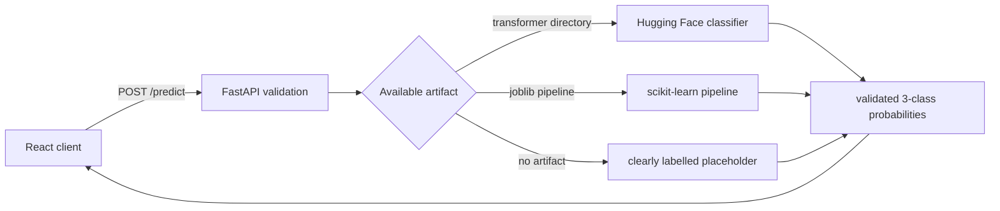

# Social-Media Hate-Speech Detection

[](frontend/)
[](backend/)
[](frontend/)
[](render.yaml)
[](vercel.json)

A full-stack moderation demo that classifies social-media text as `hate`,
`offensive`, or `normal`. The repository provides a FastAPI inference API, a
responsive React/Material UI dashboard, and explicit drop-in support for either
a scikit-learn probability pipeline or a Hugging Face sequence classifier.

> **Current model status:** the repository does not include trained weights.
> Without a model artifact, the API runs a small deterministic keyword
> heuristic and labels every response with `model_backend: "placeholder"`.
> Placeholder results are for interface testing only.

## Features

- Validated JSON API with a 2,000-character request limit
- Three-class probability response with explicit model-backend provenance
- Drop-in scikit-learn and Hugging Face transformer inference
- Model-label mapping that prevents silent probability-column swaps
- Configurable multi-origin CORS for local and deployed frontends
- Responsive dark dashboard with samples, progress bars, and error states
- Backend wake-up check and request timeout handling for free-tier deployments
- Render and Vercel configuration committed at the repository root

## Architecture



## Repository structure

```text
social-media-hate-speech-detection/
├── backend/
│   ├── app.py                 FastAPI routes, validation, CORS
│   ├── model.py               Artifact loading and inference adapters
│   ├── model_store/           Local model location; artifacts are ignored
│   ├── requirements.txt       Lightweight placeholder deployment
│   └── tests/                 Model-contract regression tests
├── frontend/
│   ├── src/App.tsx            Moderation dashboard and API client
│   ├── src/theme.ts           Material UI theme
│   └── .env.example           Frontend API URL example
├── render.yaml                Render backend Blueprint
└── vercel.json                Vercel build, SPA routing, cache headers
```

## API

### `GET /health`

Reports process health, the active model backend, and the API label contract.

```json
{
  "status": "ok",
  "model_backend": "placeholder",
  "labels": ["hate", "offensive", "normal"]
}
```

### `POST /predict`

Request:

```json
{
  "text": "A social-media post or comment"
}
```

Response:

```json
{
  "text": "A social-media post or comment",
  "label": "normal",
  "confidence": 0.85,
  "probabilities": {
    "hate": 0.05,
    "offensive": 0.1,
    "normal": 0.85
  },
  "model_backend": "placeholder"
}
```

Interactive documentation is available at `/docs` while the API is running.

## Local development

### Backend

```powershell
cd backend
python -m venv .venv
.\.venv\Scripts\Activate.ps1
pip install -r requirements.txt
uvicorn app:app --reload --port 8000
```

### Frontend

```powershell
cd frontend
npm install
npm run dev
```

The frontend defaults to `http://localhost:8000`. Copy
`frontend/.env.example` to `frontend/.env.local` to override it:

```text
VITE_API_URL=http://localhost:8000
```

## Attaching a trained model

Artifacts are checked in this order:

1. `backend/model_store/transformer/`
2. `backend/model_store/sklearn_pipeline.joblib`
3. Built-in placeholder mode

### Hugging Face transformer

Save a sequence-classification model and tokenizer in
`backend/model_store/transformer/`. Its `id2label` configuration must use
`hate`, `offensive`, and `normal`, or generic `LABEL_0`/`LABEL_1`/`LABEL_2` in
that documented order. Add CPU-compatible `torch` and `transformers` packages
to `backend/requirements.txt` before deployment.

### scikit-learn pipeline

Save a classifier pipeline that implements `predict_proba` as
`backend/model_store/sklearn_pipeline.joblib`. String-valued `classes_` are
mapped by name, so their column order may differ. Numeric classes must be
`0, 1, 2` in the documented label order. Add `scikit-learn` and `joblib` to the
backend requirements.

Model artifacts are intentionally gitignored. Use an external model registry,
private object storage, or Git LFS according to the artifact size and license.

## Deployment

### Render backend

1. Create a **Blueprint** from this repository using `render.yaml`.
2. Set `FRONTEND_ORIGINS` to the deployed frontend origin. Multiple origins may
   be comma-separated.
3. Deploy and verify `/health` and `/docs`.

The committed requirements keep placeholder mode small enough for a free CPU
instance. A transformer model may require a larger plan because PyTorch and
model weights significantly increase build size, memory use, and startup time.

### Vercel frontend

1. Import the repository.
2. Keep the root directory at the repository root; `vercel.json` supplies the
   frontend build and output paths.
3. Set `VITE_API_URL` to the Render service URL without a trailing slash.
4. Deploy after the backend is reachable.

The Vercel configuration caches hashed assets for one year while forcing the
SPA entry document to revalidate, preventing stale bundles after deployment.

## Responsible-use note

Automated moderation systems can encode dataset and annotation biases. Do not
use this demo as the sole basis for enforcement decisions. A production model
should be evaluated by class and subgroup, monitored for drift, and paired with
human review and an appeals process.

## License

No license has been selected yet. Add one before accepting external
contributions or distributing trained artifacts.
